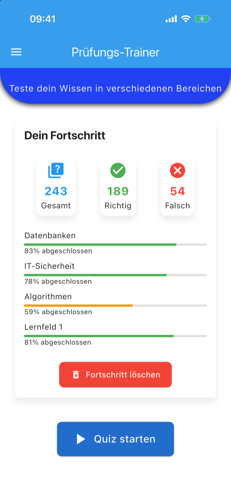
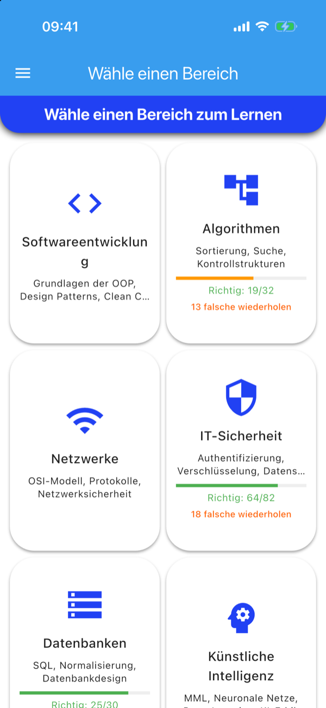
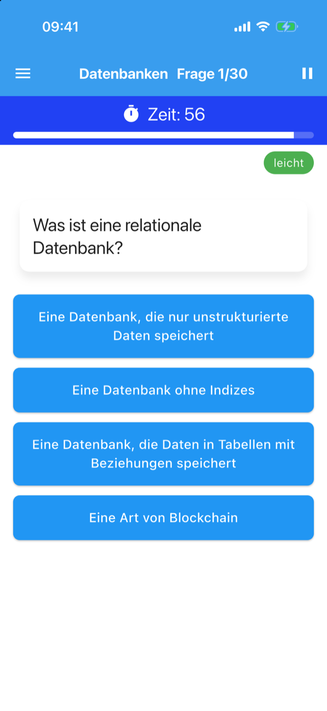
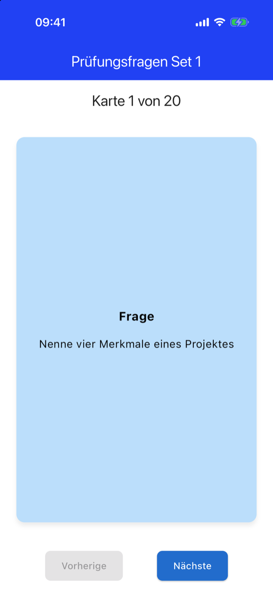
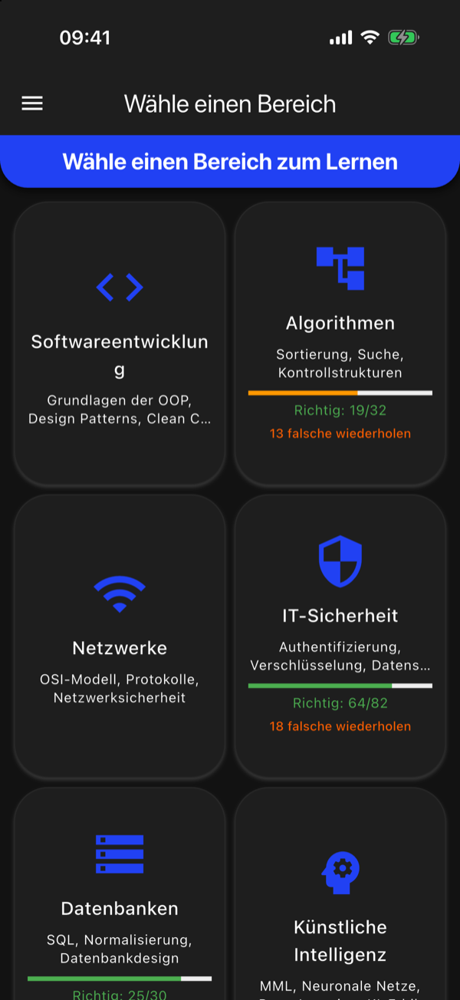
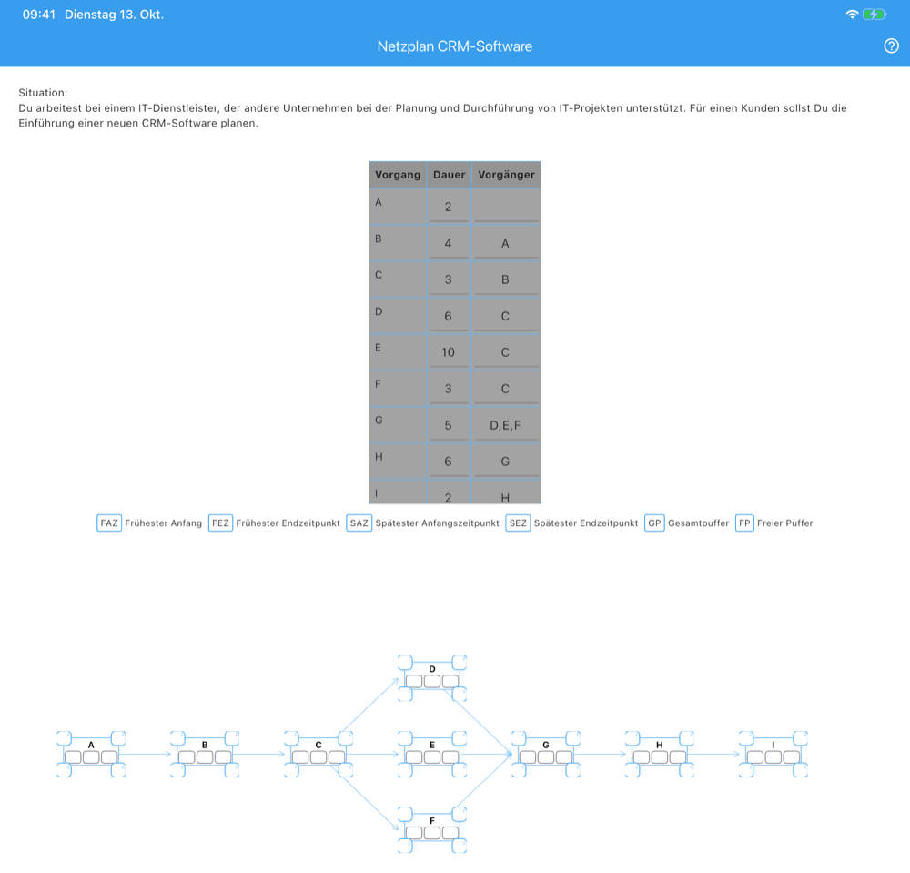

# Learnings – Prüfungs-Trainer für Fachinformatiker

Eine Flutter-App zur Vorbereitung auf die IHK-Abschlussprüfung für Fachinformatiker (Anwendungsentwicklung und Systemintegration). Sie kombiniert ein Multiple-Choice-Quiz mit Zeitlimit, Karteikarten, eine interaktive Netzplan-Übung und eine Fortschrittsstatistik in einer App für iOS und Android.

<p align="center">
  
  
  
</p>
<p align="center">
  
  
</p>
<p align="center">
  
</p>

## Funktionen

- **Quiz mit 448 Multiple-Choice-Fragen** in elf Bereichen: Softwareentwicklung, Algorithmen, Netzwerke, IT-Sicherheit, Datenbanken, Künstliche Intelligenz sowie die Lernfelder 1–5. Jede Frage hat ein 60-Sekunden-Limit (pausierbar) und einen Schwierigkeitsgrad. Die Antworten werden bei jedem Durchlauf neu gemischt.
- **Falsche Antworten wiederholen:** Die App merkt sich falsch beantwortete Fragen pro Kategorie und bietet sie gezielt zur Wiederholung an.
- **121 Karteikarten** mit Flip-Animation: simulierte Prüfungsfragen (vier Sets plus ein Set für AP Teil 2) sowie Design Patterns (Creational, Structural, Behavioral).
- **Interaktive Netzplan-Übung:** Der Netzplan wird aus einer Vorgangstabelle automatisch aufgebaut und gezeichnet. FAZ, FEZ, SAZ, SEZ, Gesamt- und freier Puffer werden direkt in die Knoten eingetragen und sofort geprüft, mit Rechentipps bei Bedarf.
- **Fortschritt und Statistik:** Richtige und falsche Antworten werden pro Kategorie und insgesamt ausgewertet, lokal gespeichert und lassen sich zurücksetzen.
- **Lernmaterial:** Integrierter PDF-Viewer für Zusammenfassungen (z. B. Design Patterns, SQL, OSI-Modell, IPv4/IPv6) und eine Sammlung von Lernvideos.
- **Light und Dark Mode** mit einem selbst gebauten, animierten Tag-/Nacht-Schalter. Die Auswahl bleibt gespeichert.

## Technische Umsetzung

| Bereich | Umsetzung |
| --- | --- |
| Framework | Flutter 3, Dart 3 |
| State Management | `provider` (Theme), `StatefulWidget` für Screen-Zustand |
| Persistenz | `shared_preferences` – Statistik, falsch beantwortete Fragen, Einstellungen |
| Inhalte | Fragen und Karteikarten als JSON-Assets, neue Fragen ohne Codeänderung ergänzbar |
| PDF | `syncfusion_flutter_pdfviewer` |
| UI | Material 3, eigene Animationen (`AnimationController`, `CustomPainter`), `flip_card`, `flutter_svg` |

Ein paar Details, die über ein einfaches Quiz hinausgehen:

- **Netzplan-Algorithmus** (`lib/screens/network_plan_screen.dart`): Die Vorgänge werden per Breitensuche in Ebenen eingeteilt und daraus positioniert. Die Sollwerte entstehen über Vorwärtsrechnung (FAZ/FEZ), rekursive Rückwärtsrechnung (SAZ/SEZ) und Pufferberechnung. Die Pfeile zwischen den Knoten zeichnet ein eigener `CustomPainter`.
- **Gemischte Antworten:** Beim Laden einer Frage werden die Antwortoptionen gemischt und der Index der richtigen Antwort neu berechnet. So lassen sich die Fragen nicht über die Position auswendig lernen.
- **Klare Trennung** von Modellen (`models/`), Persistenz (`services/`), Zustand (`providers/`) und Oberfläche (`screens/`, `widgets/`, `theme/`).

## Projektstruktur

```
lib/
├── main.dart              # Einstiegspunkt, Theme-Provider
├── models/                # Question, Category, QuizStats
├── providers/             # ThemeProvider (Light/Dark Mode)
├── screens/               # Start, Kategorien, Quiz, Karteikarten, Netzplan, Dokumente, Videos
├── services/              # StorageService (Statistik), SettingsService (Einstellungen)
├── theme/                 # Farben und Themes
└── widgets/               # Navigation, Tag-/Nacht-Schalter
assets/
├── questions.json         # Fragen nach Themenbereich
├── lernfeld1-5.json       # Fragen zu den Lernfeldern
├── *_set_*.json           # Karteikarten: Prüfungsfragen
├── *_design_patterns.json # Karteikarten: Design Patterns
└── …                      # PDF-Lernmaterial
```

### Fragen ergänzen

Neue Fragen für eine bestehende Kategorie werden nur in der passenden JSON-Datei ergänzt, der App-Code bleibt unverändert:

```json
{
  "categories": {
    "Datenbanken": {
      "description": "SQL, Normalisierung, Datenbankdesign",
      "questions": [
        {
          "id": 1,
          "difficulty": "leicht",
          "question": "Welcher SQL-Befehl liest Daten aus einer Tabelle?",
          "options": ["SELECT", "INSERT", "UPDATE", "DELETE"],
          "correctAnswer": 0
        }
      ]
    }
  }
}
```

## Starten

Voraussetzung ist ein installiertes [Flutter SDK](https://docs.flutter.dev/get-started/install) (Dart ≥ 3.6). Für iOS werden zusätzlich Xcode und CocoaPods benötigt, Mindestversion ist iOS 15.

```bash
git clone https://github.com/Ragnar-dot/Learnings.git
cd Learnings
flutter pub get
flutter run
```
## 👤 Autor

**Alexander Keterling**

- GitHub: [@Ragnar-dot](https://github.com/Ragnar-dot)
- Website: [loop-expression.de](https://www.loop-expression.de)
